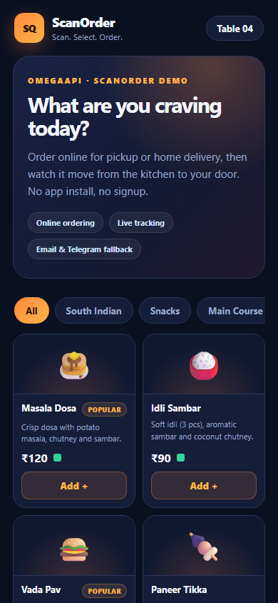
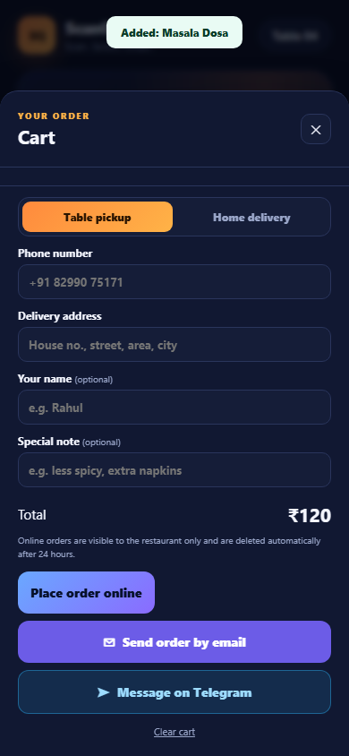
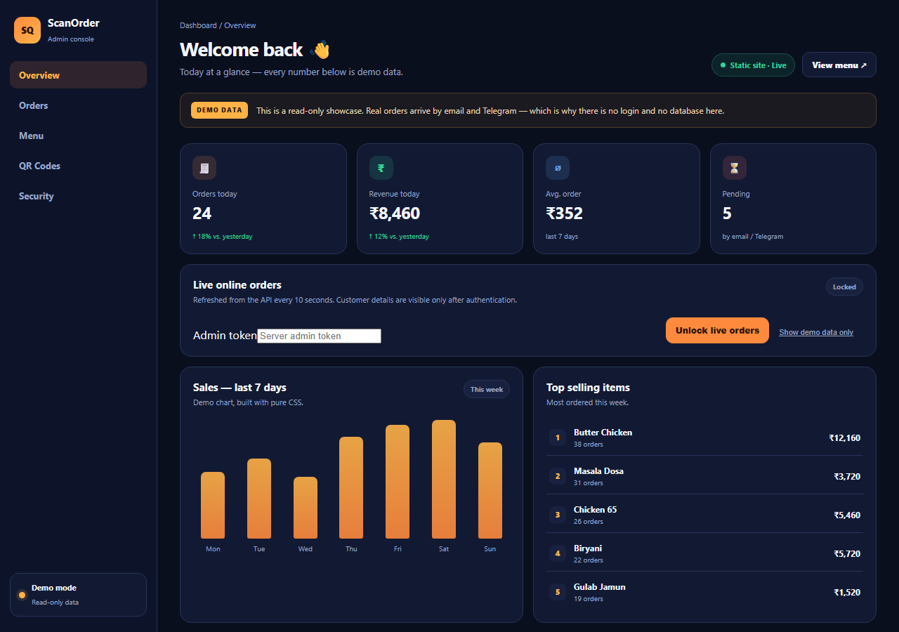
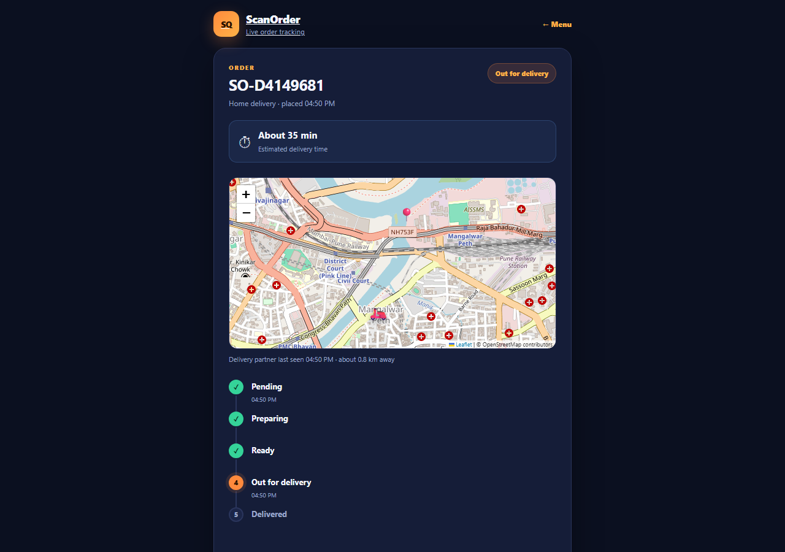
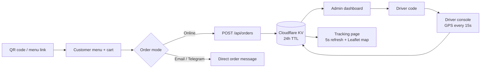

# ScanOrder — QR Menu, Online Ordering & Live Vehicle Tracking

[](https://scanorder-bjf.pages.dev/)
[](#architecture)
[](#architecture)
[](LICENSE)

> A customer scans a QR at the table — or opens the link at home — orders in under a minute, then watches the delivery partner's scooter move on a real map. Orders land in a live admin dashboard, with email and Telegram as a fallback. No app, no signup, no commission, no paid APIs.

**Live demo:** https://scanorder-bjf.pages.dev/<br>
**Built by Krishna Prakash Ojha (Leon) — OmegaAPI:** [Email](mailto:info@omegaapi.com) · [Telegram](https://t.me/Omegaapiofficial) · [omegaapi.com](https://omegaapi.com) · [GitHub](https://github.com/omegaapi-india)

---

## Why this demo gets inquiries

| A restaurant owner's problem | What the demo proves |
|---|---|
| Paying 20–30% commission on every order | Direct QR + email/Telegram ordering, **0% commission** |
| "Where is my order?" phone calls | Live map, ETA, route trail, and status timeline |
| No in-house developer to maintain software | Plain static files + serverless functions, nothing to patch |
| Fear of leaking customer data | Orders and GPS auto-delete after 24 hours; public tracking shows **no personal details** |
| Upfront cost | Cloudflare free tier, no API keys, Leaflet served from this site |

## Try the whole flow in 60 seconds

1. Open the **menu** → add two items → choose **Home delivery** → place the order. Copy the order ID.
2. Open the **admin dashboard** → the KPIs are demo data. [Email me](mailto:info@omegaapi.com?subject=ScanOrder%20demo%20token) or [message me on Telegram](https://t.me/Omegaapiofficial) for the demo token to see the incoming order and its 6-digit driver code.
3. Open the **driver console** → enter the order ID and that code → allow GPS → the scooter starts moving.
4. Open the **tracking link** from step 1 → watch the marker, route, distance, and ETA refresh every 5 seconds.

That is a complete order-to-doorstep system you can show on a phone.

### Demo pages

| Page | URL | What it shows |
|---|---|---|
| Customer menu | `/` | 14 items, 7 categories, cart, pickup/delivery |
| Live tracking | `/track.html?id=SO-A1B2C3D4` | Map, scooter marker, trail, ETA, timeline |
| Driver console | `/driver.html` | Order-scoped code + browser GPS sharing |
| Admin dashboard | `/admin/` | KPIs, chart, live orders, status control |

### Screenshots

| Menu | Cart & checkout |
|---|---|
|  |  |

| Admin dashboard | Live map tracking |
|---|---|
|  |  |

---

## What is included

**Customer**
- Mobile-first QR menu with categories, veg/non-veg markers, and "Popular" tags
- Cart with **Table pickup** or **Home delivery**
- Two ways to order: online (tracked) or by email/Telegram (works on static-only hosts)
- Live tracking page with an **OpenStreetMap map**, moving scooter marker, travelled route line, distance to destination, status timeline, and 5-second refresh

**Delivery partner**
- `driver.html` console: enter order ID + a 6-digit, order-specific driver code
- Reads the delivery address and items, then uses browser GPS (`watchPosition`)
- Sends coordinates to the API every 15 seconds while sharing is on; "Stop sharing" ends it
- No global driver password is stored in the page

**Admin**
- Demo dashboard: KPI cards, CSS chart, top items, recent orders
- Live orders panel: token-gated, refreshes every 10 seconds, shows each order's driver code
- Status changes appear on the customer's tracking page immediately

---

## How the live tracking works

1. Customer places an online order → server creates it with a random 6-digit `driverCode` (shown only in the admin panel).
2. Admin gives the code to the delivery partner, who opens `/driver.html` and starts sharing GPS.
3. `POST /api/orders/:id/location` validates the code and stores `{lat, lng, at}` plus a 40-point trail in KV.
4. Customer's `/track.html` polls the public order endpoint every 5 seconds and moves the scooter marker along the route.



**Free-tier note:** Cloudflare KV allows 1,000 writes/day, so the driver app throttles updates to one every 15 seconds. That is perfect for a demo. For all-day continuous tracking, switch the location store to a Durable Object (WebSocket) — the rest of the code stays the same.

---

## Architecture

| Layer | Technology | Cost |
|---|---|---|
| Frontend | Static HTML/CSS/JS | Free |
| Map | Leaflet (vendored in `vendor/leaflet`) + OpenStreetMap tiles | Free, no key |
| API | Cloudflare Pages Functions (Workers) | Free tier: 100k requests/day |
| Storage | Cloudflare KV, 24h TTL | Free tier: 100k reads / 1k writes per day |
| CI/CD | GitHub Actions + Wrangler | Free tier: 2,000 minutes/month |
| Security headers | `_headers` (CSP, nosniff, no-referrer) | Free |

---

## Security and privacy

| Risk | Mitigation |
|---|---|
| Server hack / RCE | Pages Functions are isolated Workers; no VM to patch |
| SQL injection | No SQL database; KV key-value only |
| API key leak | No keys in the browser. Admin token is a server secret; driver auth uses a per-order code |
| Client-side price tampering | Server recalculates every total from its own price map |
| Fake GPS updates | Location endpoint requires the order-specific 6-digit driver code; lat/lng ranges are validated |
| Driver code leak | Code is never returned by the public tracking API |
| XSS | Dynamic text uses `textContent`; `innerHTML` only receives fixed strings |
| Spam orders / GPS flooding | Per-IP order limit (5/10 min) and per-order location throttle (12s) |
| Clickjacking | `X-Frame-Options: DENY` and CSP `frame-ancestors 'none'` |
| Third-party scripts | No analytics, font CDN, or remote JS — Leaflet is served from this site |
| Map tile requests | Tile images load from OpenStreetMap; the viewer's approximate area is disclosed to OSM. `CSP img-src` allows only those tile hosts |
| Data retention | Orders, phone numbers, addresses, and GPS trails auto-delete from KV after 24 hours |
| Public tracking leak | The tracking API returns status, items, total, and driver location only — never name, phone, address, or driver code |

**Honest note:** online delivery does store a name, phone number, address, and GPS trail for up to 24 hours. It is readable only through the token-protected admin API or the order-scoped driver code, and is never logged or sent to any third party other than OpenStreetMap map tiles. If you do not want that, use email/Telegram-only mode on a static host.

---

## Customize it

1. **`assets/config.js`** — contact email, Telegram link, portfolio name, business name, currency, default table, and demo coordinates:
   - `contactEmail` / `telegramUrl` — where direct order messages go
   - `restaurant`: kitchen location on the map
   - `dropPoint`: demo delivery destination (real address geocoding would need a geocoder)
2. **`assets/menu.js`** — your items, prices, descriptions. Every `id` must be unique.
3. **`lib/api.js`** — keep the `PRICES` and `NAMES` maps in sync with `assets/menu.js`.
4. **`index.html` / `admin/index.html`** — titles, hero copy, brand name, demo numbers.
5. **`_headers`** — if you swap map providers, update the `img-src` allowlist.

---

## Run locally

**Static-only mode (menu + email/Telegram):**
```bash
cd scanorder-qr-menu
python -m http.server 8000
```

**Full stack with API and map:**
```bash
cp .dev.vars.example .dev.vars   # set a test ADMIN_TOKEN
npx wrangler pages dev . --kv ORDERS --port 8000
```
Local KV is emulated — no Cloudflare account needed for testing. Browser GPS requires `localhost` or HTTPS.

---

## Deploy (free, ~10 minutes)

1. Create a public GitHub repo and push this folder.
2. Cloudflare Dashboard → **Workers & Pages** → **Create** → **Pages** → connect the repo.
3. Build command: **leave empty** · Output directory: **`.`** (root).
4. Create a KV namespace (`Workers & Pages → KV → Create namespace`).
5. Settings → Functions → KV namespace bindings → bind variable **ORDERS** to that namespace.
6. Settings → Environment variables → add secret **ADMIN_TOKEN** (long random string).
7. Deploy. `_headers`, the `/api/*` functions, and the vendored Leaflet files are picked up automatically.

**GitHub Pages / Netlify / Vercel:** static pages and email/Telegram ordering still work; online ordering, driver GPS, and tracking need Cloudflare Pages Functions.

### Current deployment

| Item | Value |
|---|---|
| Pages project | `scanorder` |
| Production URL | https://scanorder-bjf.pages.dev/ |
| KV namespace | `scanorder-orders` (binding `ORDERS`, ID in `wrangler.toml`) |
| Admin secret | `ADMIN_TOKEN` (set with `wrangler pages secret put`, never committed) |
| Redeploy | `npx wrangler pages deploy . --project-name scanorder` |

### Auto-deploy

Pushing to `main` triggers `.github/workflows/deploy.yml`, which runs Wrangler against the same Pages project. Required repository secrets (both encrypted in GitHub, never in source):

- `CLOUDFLARE_API_TOKEN` — scoped to Account → Cloudflare Pages → Edit
- `CLOUDFLARE_ACCOUNT_ID` — `19bc8544dc0990e95dbc23bf96193fba`

The Cloudflare project stays a Direct Upload project, so native Pages Git integration is not available; GitHub Actions provides the same push-to-deploy behaviour without changing the live URL.

> Automated clients may receive an HTTP 403 from Cloudflare's browser check. Use a normal browser; real users are not affected.

---

## API endpoints

| Method | Path | Auth | Purpose |
|---|---|---|---|
| POST | `/api/orders` | public | Create an order (rate-limited; server validates items and total) |
| GET | `/api/orders/:id` | public | Tracking data: status, items, total, driver location |
| GET | `/api/orders/:id/driver` | `x-driver-code` | Delivery details for the assigned partner |
| POST | `/api/orders/:id/location` | `x-driver-code` | Share GPS coordinates (throttled) |
| GET | `/api/admin/orders` | `Bearer <ADMIN_TOKEN>` | List live orders, including driver codes |
| PATCH | `/api/admin/orders/:id` | `Bearer <ADMIN_TOKEN>` | Update order status |

Example:
```bash
curl -X POST https://your-site.pages.dev/api/orders \
  -H 'content-type: application/json' \
  -d '{"mode":"delivery","name":"Rahul","phone":"+919900000000","address":"12 Main Street, Pune","items":[{"id":"m1","qty":2}]}'
```

---

## Generating the QR codes

1. Append `?table=01`, `?table=02`, etc. to the live menu URL for each table.
2. Generate QR images with any free QR tool and print them.
3. For delivery, share the plain menu link — customers choose **Home delivery** in the cart.

> The QR shown in the admin dashboard is a decorative mockup. No external QR tool is bundled with this repo.

---

## Want this for your business?

This is a working demo, not a mockup. It can be rebranded for a restaurant, café, cloud kitchen, pharmacy, or any shop that takes orders and delivers locally.

- **Live demo:** https://scanorder-bjf.pages.dev/
- **Email for a walkthrough or a custom quote:** [info@omegaapi.com](mailto:info@omegaapi.com)
- **Telegram:** [t.me/Omegaapiofficial](https://t.me/Omegaapiofficial)
- **Website and more projects:** https://omegaapi.com · https://github.com/omegaapi-india

> "I built a complete ordering system for a restaurant. Customers scan a QR at the table or order from home, then watch the delivery partner move on a live map until the food arrives. Orders appear in a simple dashboard and by email/Telegram. No app install, no commission, no monthly fee. Let me show you it working."

---

## Demo access and data safety

Every public demo is a **3-day free trial**. Access is enforced by a signed, HttpOnly cookie issued by a Cloudflare Pages Function. There is no payment form, card field, subscription, or paid API key in any demo.

The cookie contains only a timestamp and a random nonce. No IP address, name, email, phone number, or order/booking/trade detail is stored in it. Customer-facing public pages and APIs continue to hide personal data, and existing data-retention rules still apply. Clearing browser cookies starts a fresh trial; a commercial deployment should add accounts and billing for hard entitlement control.

Local development and deployment need one extra secret:

```bash
# add to .dev.vars
DEMO_TRIAL_SECRET=replace-with-a-long-random-string

# upload for production
npx wrangler pages secret bulk .dev.vars --project-name scanorder
```

## ❤️ Sponsor this project

If ScanOrder saves you time or helps your business, please consider sponsoring OmegaAPI. It keeps the live demo online and lets me keep building free, open-source tools.

[](https://github.com/sponsors/omegaapi-india)

Goal: **10 monthly sponsors**. [View monthly tiers ($5, $25, $100, $250)](https://github.com/sponsors/omegaapi-india?interval=monthly). Every monthly sponsor helps. Can't sponsor? A ⭐ on this repo or sharing it with someone who needs it helps too!

## License

MIT — free to use, modify, and show to clients.

Built by **Krishna Prakash Ojha (Leon)** for **OmegaAPI** · [omegaapi.com](https://omegaapi.com) · [Email](mailto:info@omegaapi.com) · [Telegram](https://t.me/Omegaapiofficial) · [GitHub](https://github.com/omegaapi-india)
